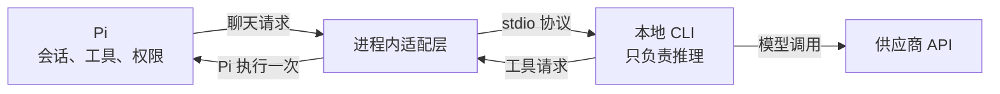
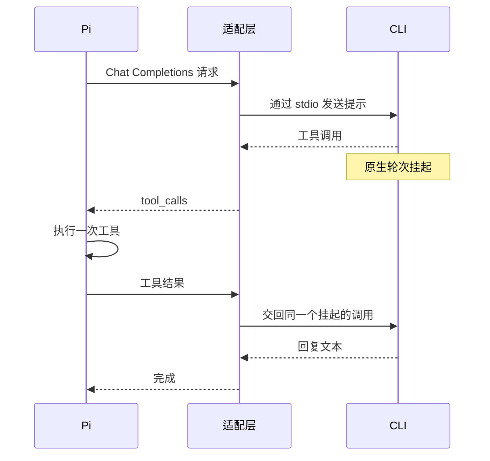

# pi-local-cli

[](https://github.com/ErkundenSie/pi-local-cli/actions/workflows/ci.yml)
[](./LICENSE)
[](https://nodejs.org)

把本机已安装并登录的 AI 编程 CLI 作为模型接入 [Pi](https://github.com/earendil-works/pi)。

Pi 以子进程方式启动 CLI，并通过 stdio 使用它自己的协议：Codex 走 App Server，其余走 ACP。CLI 使用自己的登录状态直接访问自己的供应商。推理不读取登录令牌，也不代理账号。Claude 配额只来自官方命令。Grok 的最后一道配额回退可能读取它自己的登录文件，但不保存、不记录、不展示令牌。不需要 Magpie 或 Bun。**本地启动 CLI 不等于离线推理。**

[English](./README.md)

## 特性

- **真实的模型条目**：`/model` 中出现 `local-cli/<agent>-<model>`，具体型号由 CLI 自己报告。
- **原生流式输出**：回复文本、思考文本和 token 用量随 CLI 产生而实时到达。
- **Pi 工具留在 Pi**：Pi 会话声明的工具通过本机 MCP 暴露给 CLI。CLI 原生调用，Pi 在自己的工具循环中执行一次，沿用 Pi 的权限、钩子和结果渲染。
- **复用会话，不重复历史**：模型、思考级别、工具清单和历史前缀都一致时复用原生会话；否则在新会话中重放历史。
- **Antigravity 跨重启恢复**：已完成的 `agy` 会话可在 Pi 或 CLI 重启后继续，只发送新增消息。
- **分项统计**：上下文占用、最近一次推理用量和整轮累计分开显示，不混为一谈。
- **失败不重复执行**：无法再送达的工具结果会明确报错，绝不自动重放。

## 支持的 CLI

| CLI | 启动方式 | 准备 |
|---|---|---|
| OpenAI Codex | `codex app-server --listen stdio://` | 安装 Codex，执行 `codex login` |
| Claude Code | `claude-agent-acp` 包装现有的 `claude` | 安装原生 Claude Code，再 `npm install -g @agentclientprotocol/claude-agent-acp` |
| Google Antigravity CLI | `agy acp` | 安装 Antigravity CLI，并用 `agy` 登录 |
| Grok Build | `grok agent --no-leader stdio` | 安装 Grok Build，执行 `grok login` |

检测到可执行文件不代表登录可用，运行 `/local-cli doctor` 查看当前状态。

## 要求

- Node.js 22 或更高版本。
- 支持原生 provider 注册与自定义 `fetch` 的 Pi（已验证 Pi 1.5.2）。
- 至少一个已在终端登录的受支持 CLI。

## 安装

```bash
pi install git:github.com/ErkundenSie/pi-local-cli
```

从本地检出安装：

```bash
git clone https://github.com/ErkundenSie/pi-local-cli
cd pi-local-cli
npm ci
pi install .
```

只在一次会话中试用：

```bash
pi -e /absolute/path/to/pi-local-cli/index.mjs
```

然后运行 `/local-cli` 查看检测结果，用 `/model` 选择 `local-cli/*` 模型。

### 在 Pi Web 中使用

重启 Pi Web 服务，打开 **设置 → 模型 → Local CLI**（无需 API Key），点击 **刷新模型目录**，打开需要的模型并 **保存**。已有 `enabledModels` 白名单不会自动加入新模型。

列表中的 `Antigravity (agy)` 和 `xAI (Grok/X subscription)` 是独立 provider，不是本插件的 `Local CLI`。

## 模型命名

```
local-cli/<agent>-<原生模型 ID>    例：local-cli/codex-gpt-6.2-sol
local-cli/<agent>-default          由 CLI 决定使用哪个模型
```

模型发现走与聊天相同的协议，不需要额外登录或 API Key。CLI 不报告目录时只出现 `-default` 条目。

## 命令

| 命令 | 作用 |
|---|---|
| `/local-cli` | 查看检测到的可执行文件 |
| `/local-cli status` | 当前会话上一轮正在做什么 |
| `/local-cli doctor` | 可执行文件、目录来源、桥接、恢复设置和最近一轮状态 |
| `/local-cli doctor probe` | 立即查询目录（不推理，不修改启用列表） |
| `/local-cli usage` | 上下文占用、最近一次推理用量、整轮累计，以及各 CLI 的官方配额 |

## 配置

默认可执行文件从 `PATH`、常见安装目录以及 Windows 上的 Codex Desktop 包中查找。需要固定路径时，把 `.local-agents.example.json` 复制为 `index.mjs` 同目录下的 `.local-agents.json`：

```json
{
  "executables": {
    "antigravity": "C:/Users/you/AppData/Local/agy/bin/agy.exe"
  }
}
```

只保留需要的条目。Windows 优先使用 `.exe`，也接受标准 npm `.cmd`（解析到其 JavaScript 入口，不经过 `cmd.exe`），并支持前置参数：

```json
{ "path": "D:/Tools/node.exe", "args": ["D:/Tools/cli-entry.mjs"] }
```

Claude Code 本体必须是原生可执行文件；只有 ACP 适配器可以是 npm shim。

| 环境变量 | 作用 |
|---|---|
| `PI_LOCAL_CLI_CONFIG` | 指定其他可执行文件配置的绝对路径 |
| `PI_LOCAL_CLI_AGY_RESUME=0` | 关闭 Antigravity 磁盘恢复点，仅保留进程内复用 |

可执行文件配置属于插件使用者，不会从当前项目读取覆盖。只配置你信任的二进制和脚本，它们以你的身份运行。

## 设计原则

CLI 只作为大脑。Pi 保留手脚架：对话状态、工具、权限、钩子和结果渲染。插件不调用 CLI 自带的文件、命令或网页工具，也不保存 CLI 的登录状态。



| 职责 | 归属 |
|---|---|
| 模型推理与供应商登录 | 本机已安装的 CLI |
| 工具、权限、钩子和渲染 | Pi |
| 协议转换与挂起工具的结果交回 | 本插件 |
| CLI 自带的文件、命令和网页工具 | 关闭或拒绝 |

一次工具调用不会离开 Pi 的循环：



如果挂起的调用已经丢失，结果不会再次发送。后续消息会开启新轮次，而不是重放可能已经执行过的操作。

## 工作原理

```
Pi  ──Chat Completions──▶  进程内适配层  ──stdio JSON-RPC──▶  codex app-server / agy acp / grok agent / claude-agent-acp
 ▲                                                                          │
 └──────────────── Pi 工具桥（本机回环 MCP，随机端口 + 令牌）◀───────────────┘
```

- Chat Completions 在进程内适配，没有 HTTP 端点，也没有监听聊天流量。
- 唯一的监听器是按需启动的本机回环 MCP 桥：绑定 `127.0.0.1`、随机端口、按会话发放令牌。CLI 自己启动连接它的 stdio shim。
- CLI 调用 Pi 工具时原生轮次会挂起；Pi 在自己的工具循环中执行，再把结果交回同一个挂起的调用。
- 每个 CLI 在自己的临时目录中启动，内置工具受限；插件无法回答的审批请求一律拒绝。

### 超时

每个原生轮次最多推理 5 分钟，只统计 CLI 正在生成的时间。等待 Pi 工具时暂停该预算，并有独立的 10 分钟上限，同时仍受 CLI 自身更短的限制约束。Pi Web 会显示正在等待、超过 20 秒仍在运行，或已失去桥连接。

如果结果无法再送达——桥断开、等待过期、轮次取消——请求会失败而不是静默重放。继续聊天前，先检查对话中已经产生的工具输出。

### Antigravity 恢复点

每轮正常完成后，原生进程保留供复用，并在 `<agentDir>/local-cli/agy-checkpoints`（通常是 `~/.pi/agent/local-cli/agy-checkpoints`，权限 0600）写入恢复点。恢复点只包含原生会话 ID、模型、时间与历史/工具指纹，不保存消息、工具输出、图片或令牌。

重启后只有在以下条件全部满足时才恢复：上一轮正常完成、原宿主进程已退出或已释放租约、模型与设置、工具清单、历史前缀全部匹配。推进原生历史前会先使旧恢复点失效，因此半途中断的轮次无法被恢复。恢复点 6 小时后过期。切换分支、压缩历史、升级 CLI 或恢复被拒时，退回使用 Pi 已保存历史的新会话。挂起中的工具调用永不恢复。

Codex 只保留进程内线程：`ephemeral: true` 的线程没有磁盘 rollout，重启 App Server 后 `thread/resume` 在设计上不可用（已在 App Server 0.171.0 验证）。Grok 和 Claude Code 暂不使用磁盘恢复点。

## 行为说明

- 向 Pi 注册的上下文窗口按模型区分：
  - **Antigravity CLI：** Gemini 4 Neon 按 [Antigravity 官方文档](https://antigravity.google/docs/models#gemini-4-neon)采用 512,000 tokens，即使本机面板显示更高；Gemini 4 Carbon、Argon、Hydrogen、Gemini 3.8 Flash 和 Claude Opus/Sonnet 5.5 按 Antigravity CLI 的 [`/context` 面板](https://antigravity.google/docs/cli/commands/context)采用 1,000,000。GPT-OSS 120B 使用 131,072。[Orchestrator](https://antigravity.google/docs/models#orchestrator) 取规划模型与 Hydrogen 执行模型中较小的窗口：Carbon/Argon 为 1,000,000，Neon 为 512,000，即使本机面板三项都显示 1M。
  - **Codex / Grok Build：** 优先按型号从各自本地的 `models_cache.json` 读取 `context_window`，不采用 Codex 可选的 `max_context_window` 或 [Grok API 的上限](https://docs.x.ai/developers/pricing)替代 CLI 的值。对于已发现但缓存未提供窗口的 Codex 模型，GPT‑6.1 Sol/Terra 使用 500,000，GPT‑6 Sol/Luna 使用 272,000。
  - **Claude Code：** 明确选中的 Opus/Sonnet/Haiku 5.5 使用 [原生 1M 窗口](https://code.claude.com/docs/en/model-config#extended-context)；启动环境设了 `CLAUDE_CODE_DISABLE_1M_CONTEXT=1` 时使用 200,000。
  - 每个 `CLI default` 别名使用该 CLI 已发现模型中最小的窗口。没有发现任何模型时回退到 128,000；已发现但窗口未知的模型也按 128,000 参与计算。以上数值用于 Pi 的上下文显示和压缩判断，不会改变 CLI 或供应商的实际限制。
- **单次请求的最大输出：** 所有模型（包括 `CLI default` 别名）向 Pi 注册的 `maxTokens` 都是 16,384 tokens。这是模型元数据，不是插件强制执行的输出上限：桥接层不会把 `max_tokens` 转发给原生 CLI，实际输出限制由 CLI 和供应商决定。
- 只有 CLI 声明支持时才会转发图片。序列化请求（历史、内联图片与工具）上限 64 MiB；实际发给 CLI 的文本记录上限 32 MiB。这些是字节限制，与模型的 token 窗口独立。超限返回 HTTP 413，让 Pi 可以尝试压缩。
- Codex 在本插件下以只读、免审批、临时线程运行。其他 CLI 保留自己的配置；调用方工具集之外的原生工具会被拒绝。
- **这不是通用 OS 沙箱。** 模型仍可请求 Pi 会话已启用的工具，最终由 Pi 决定如何执行。
- MCP 桥面向单用户开发机：同一用户身份运行的其他进程可以从 CLI 配置中读到按会话令牌。
- 订阅额度与账单由各 CLI 供应商管理。Grok Build 返回 `HTTP 402` 时请检查该账号余额，这与模型发现、Pi API Key 或会话恢复无关。
- Pi Web 顶栏没有区分整轮累计用量与上下文占用，因此 `/local-cli usage` 更精确。统计只保存在当前会话内存中。

## 故障排查

| 现象 | 检查 |
|---|---|
| `/model` 中缺少某个 CLI | `/local-cli doctor`，再试 `doctor probe`；需要时在 `.local-agents.json` 固定路径 |
| 只出现 `-default` 模型 | 在 Pi Web 刷新目录或运行 `/local-cli doctor probe`；CLI 可能未登录 |
| Antigravity 模型没有思考级别 | 目录回退到 `agy models`，模型集合可用但可能不包含思考级别 |
| 工具执行时轮次卡住 | `/local-cli status`；等待有上限，桥断开会被报告而不是重试 |
| Antigravity 从不恢复 | 要求上一轮已完成、历史前缀匹配、恢复点未超过 6 小时 |

## 开发

```bash
npm ci
npm test          # 模拟 Codex App Server 和 ACP，不消耗账号额度
npm run doctor    # 列出检测到的可执行文件
```

测试覆盖流式输出、用量、工具往返、取消、桥与进程丢失、恢复点租约、恢复匹配和模型发现。以下脚本会使用真实 CLI 或真实 Pi Web，消耗真实额度：

```bash
node scripts/smoke-agy-pi-web.mjs <pi-web-install-path>          # 模拟 ACP
node scripts/smoke-agy-pi-web.mjs <pi-web-install-path> --live   # 真实 agy
node scripts/benchmark-agy.mjs 2 [--cold-resume]                 # 回复延迟
node scripts/probe-codex-resume.mjs [codex-model-id]             # 临时线程恢复探测
```

代码结构：

| 路径 | 作用 |
|---|---|
| `index.mjs` | Pi 入口：注册 provider、命令和状态上报 |
| `lib/provider.mjs` | 轮次生命周期：模型路由、挂起、复用与恢复 |
| `lib/model-discovery.mjs`、`lib/catalog.mjs` | 可执行文件探测与目录发现 |
| `lib/history.mjs` | 历史/工具指纹、前缀匹配与续接提示 |
| `lib/session.mjs`、`lib/session/*` | Codex App Server 与 ACP 适配器，共用传输层 |
| `lib/tool-bridge.mjs`、`lib/mcp-stdio.mjs`、`lib/bridge-server.mjs` | 本机回环 MCP 工具桥 |
| `lib/checkpoints.mjs` | Antigravity 恢复点存储与租约 |

## 致谢

协议处理与 MCP 工具桥设计移植自 [ErkundenSie/magpie-local-agents](https://github.com/ErkundenSie/magpie-local-agents)（MIT）。上游的 Magpie 页面插件、网关和订阅额度界面未包含在内。

## 许可证

[MIT](./LICENSE)
